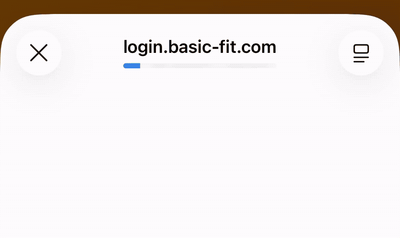

# Basic Fit QR Generator

> **Accéder au site :** [https://kurbutoke.github.io/Basic/](https://kurbutoke.github.io/Basic/)

**Basic Fit QR Generator** est une application web (PWA) gratuite et open-source pour générer votre **QR code d'accès Basic Fit**. 
Plus besoin de l'application officielle : accédez à votre salle de sport rapidement, même sans connexion internet. Compatible **iPhone**, **Android**, PC et Mac.

## 🚀 Fonctionnalités

- **Génération de QR Code** : Crée un QR code valide rafraîchi automatiquement toutes les 5 secondes.
- **Multi-Profils** : Enregistrez plusieurs comptes (famille, amis) et switchez facilement.
- **Mode PWA** : Installable comme une application sur votre téléphone (Android/iOS) pour un accès hors-ligne et rapide.
- **Thèmes** : Supporte le mode clair et le mode sombre (Dark Mode).
- **Plein Écran** : Idéal pour passer le portique facilement, cliquez simplement sur le QR Code.
- **Favoris** : Définissez un profil par défaut qui se charge automatiquement au démarrage.

## 📋 Prérequis

Pour utiliser ce générateur, vous avez besoin de deux informations uniques liées à votre compte Basic Fit :
1. **Numéro de Carte** (`card-Number`)
2. **Device ID** (`deviceID`)

## 🛠️ Comment récupérer ses informations ?

Voici la méthode pour retrouver vos identifiants :

1. **Déconnexion** : Sur l'appareil qui utilise habituellement l'application Basic Fit, déconnectez-vous de votre compte.
2. **Page de connexion** : Lancez la page de connexion en cliquant sur "Connexion".
3. **Copier l'URL** : Une fois sur la page de connexion (popup), appuyez longuement sur la barre d'adresse (l'URL) et sélectionnez "Copier".
   
   
4. **Utiliser les infos** : Revenez sur le générateur.
   - **Option A (Facile)** : Collez directement l'URL complète dans le champ "Connexion via URL (Magic Link)". Le site remplira automatiquement vos infos.
   - **Option B (Avancé)** : Collez l'URL dans une note pour chercher manuellement :
     - `card-Number=` (ex: `V123456789`)
     - `deviceID=` (ex: `8d20fc96-...`)

*Note : Ces informations sont personnelles, ne les partagez pas.*

## 💻 Installation / Utilisation Locale

Il s'agit d'une application web statique constituée de fichiers HTML, CSS et JavaScript purs.

1. Téléchargez les fichiers du projet.
2. Ouvrez le fichier `index.html` dans vote navigateur.
3. Renseignez vos informations et lancez le générateur.

## 📱 Installation Mobile (PWA)

Ce site est une Progressive Web App (PWA), vous pouvez l'installer comme une app native :

**iOS (Safari)** :
1. Ouvrez le site dans Safari.
2. Appuyez sur le bouton "Partager" (carré avec une flèche vers le haut).
3. Sélectionnez "Sur l'écran d'accueil".

**Android (Chrome)** :
1. Ouvrez le site dans Chrome.
2. Appuyez sur le menu (3 points verticaux).
3. Sélectionnez "Installer l'application" ou "Ajouter à l'écran d'accueil".

## 📄 Crédits

Ce projet s'appuie sur la documentation technique de [Szeroki](https://blog.szeroki.fr/posts/les-qr-codes-de-basic-fit-comment-ca-fonctionne).

